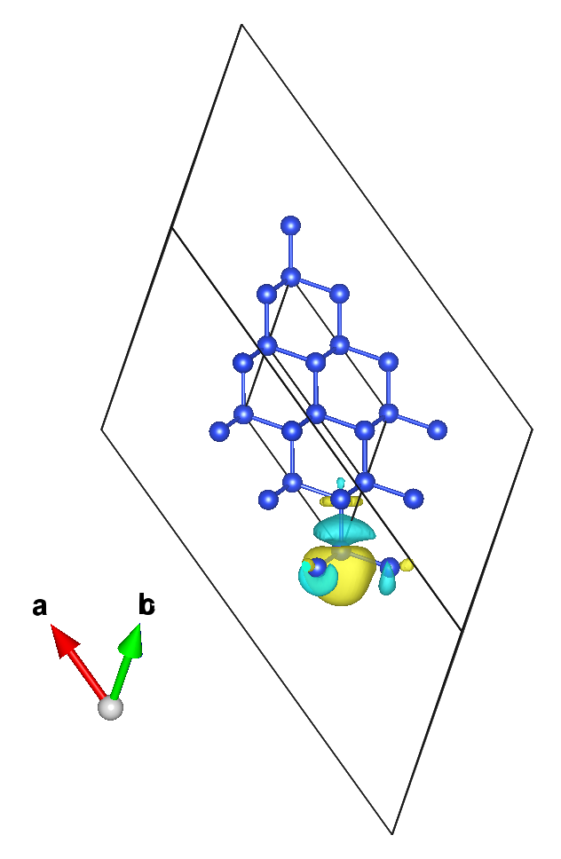
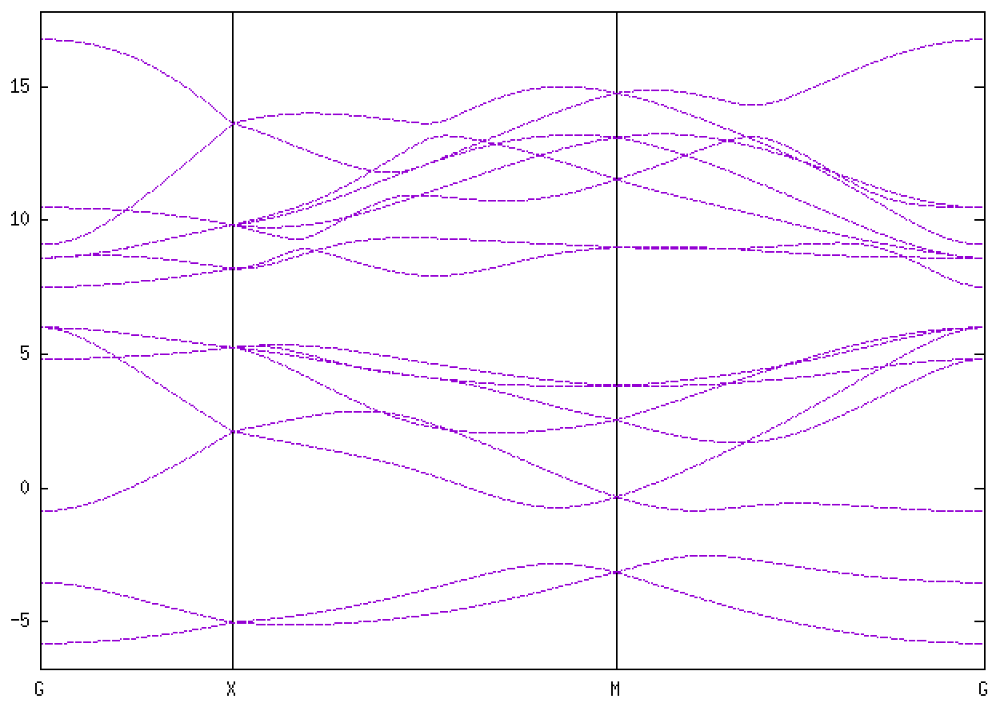

==============================================
Tutorial 16: Wannier Functions via Wannier90
==============================================

:Author: Chengcheng Xiao
:Date: November 2026

Introduction
^^^^^^^^^^^^

ONETEP can write the input files needed by the `Wannier90
<https://wannier90.readthedocs.io>`_ code, which constructs maximally localised
Wannier functions (WFs) from the ONETEP wavefunctions. The WFs give you
well-defined centres and spreads, and a compact real-space Hamiltonian which
can be used for interpolation of band structures and for transport and
topological analyses.

The interface is built on Wannier90 version 4, and this tutorial describes how
to use it in standalone mode: ONETEP only writes the files, and the
wannierisation itself is performed by running the separate
:code:`wannier90.x` executable.

Here, taking diamond silicon as an example, we will write the Wannier90 files
for a 4-atom cell, wannierise them, plot the resulting Wannier functions and
plot the Wannier-interpolated band structure. The full input can be found in
the file :download:`Si_nscf_w90_mesh.dat
<_static/tutorial_16/Si_nscf_w90_mesh.dat>`.

Building ONETEP with the interface
^^^^^^^^^^^^^^^^^^^^^^^^^^^^^^^^^^

The interface needs the Wannier90 library. A copy of Wannier90 v4 is included
in the ONETEP distribution, under the :file:`wannier90/` directory, and is
built when ONETEP is configured with

::

   BUILD_W90 = yes

in the :file:`Makefile`. This also installs the standalone :code:`wannier90.x`
executable in :file:`bin/`, which is the one you will run below. It is
therefore not necessary to install Wannier90 separately, but if you do, use a
v4 build so that the files exchanged with ONETEP are the same version.

Setting up the calculation
^^^^^^^^^^^^^^^^^^^^^^^^^^

The files are written by the NSCF stage of a calculation, so the task chain
must contain an NSCF stage followed by a properties stage, for example

::

   task : SinglePoint NSCF Properties_NSCF

The :code:`SinglePoint` task finds the ground state, the :code:`NSCF` task
re-uses the ground-state density kernel and NGWFs and diagonalises the
Hamiltonian at its own k-points, and the :code:`Properties_NSCF` task writes
the Wannier90 files.

The separate NSCF stage is there for speed. Wannier90 needs the full k-point
mesh, with no symmetry reduction, and an SCF calculation at that mesh would
cost several times more than one at the symmetry-reduced mesh. Instead, the
SCF converges the NGWFs and the density kernel at its usual mesh, and only the
diagonalisation is repeated at the full mesh.

Because the files are written by the NSCF stage, the k-points must be set
explicitly for that stage, using :code:`nscf_kpoints`. A mesh can be requested
with

::

   nscf_kpoints : MESH
   nscf_kpoint_grid_size : 7 7 7
   nscf_kpoint_gamma_centred : T

The SCF k-points (:code:`kpoint_grid_size`) are independent of this and are
only used to converge the ground state. The NSCF mesh must be the grid that
contains the Gamma point, and must **not** be reduced by symmetry:
:code:`nscf_kpoint_symmetry` must be :code:`F`, which is its default. ONETEP
writes the mesh as :math:`k=(i/n_1,j/n_2,l/n_3)` in wannier90's own k-point
order and derives :code:`mp_grid` from it, so any other shift is rejected. A
Monkhorst-Pack mesh contains Gamma only for an odd number of points in a
direction, which is why :code:`nscf_kpoint_gamma_centred : T` is needed for
even meshes; for odd ones it has no effect. Because ONETEP generates the mesh,
you do not need to write the k-point list yourself.

It is also strongly recommended to use an odd number of points along each
direction. Because of the way ONETEP constructs its G-vectors, tests show that
the Wannier functions come out real only when odd grids are used.

The NSCF grid can also be given explicitly, with the same convention as the
SCF grid:

::

   nscf_kpoints : LIST

   %block nscf_kpoint_list
   0.0 0.0 0.0
   0.0 0.0 0.5
   0.0 0.5 0.0
   ...
   %endblock nscf_kpoint_list

Each line gives a k-point in fractional coordinates, optionally followed by
its weight (default 1), and the list is used exactly as given. ONETEP does not
reduce an explicit list by symmetry, so it is your responsibility to check
that the grid is correct.

The same route works without an NSCF stage: if the full mesh is given as the
SCF k-points in the :code:`%block kpoints_list` block, then those are the
k-points written to the Wannier90 files. An explicit list is not reduced by
symmetry in this case either, so again you must supply the complete mesh.

Because the NSCF stage works at finite k-points, the NGWFs must be complex and
extended, and the plane-wave k-point method must be used:

::

   use_cmplx_ngwfs : T
   ngwfs_init_recip : T
   extend_ngwf : T T T
   kpoint_method : PW

Note that only plane-wave mode via fully extended NGWFs is supported. The NSCF
stage also needs to know how many states are occupied, which is set by

::

   cond_num_states : 16

With :code:`nscf_kpoints` set to :code:`MESH` or :code:`LIST`,
:code:`cond_num_states` is the number of occupied states counting both spins
(16 for the 4-atom silicon cell), so it must be even when the calculation is
not spin polarised.

It is usually a good idea to use kpar parallelisation, in which a number of
ONETEP instances each handle a subset of the k-points

::

   num_kpars : 4

If :code:`num_kpars` is greater than one, the full output of each kpar group
is only printed when :code:`output_detail` is set higher than
:code:`Normal`.

Wannier90 keywords
^^^^^^^^^^^^^^^^^^

The interface is controlled by a small set of :code:`w90_*` keywords:

::

   w90_write_mmn : T
   w90_write_amn : T
   w90_write_eig : T
   w90_write_unk : T
   w90_num_wann : 16
   w90_num_bands : 16
   %block w90_projections
   Si:sp3
   %endblock w90_projections

Each :code:`w90_write_*` keyword enables one of the Wannier90 files:

- :code:`w90_write_mmn` writes the overlap matrices between neighbouring
  k-points, which Wannier90 needs to construct the Wannier functions.
- :code:`w90_write_amn` writes the projections of the bands onto the initial
  guess orbitals.
- :code:`w90_write_eig` writes the band energies at the NSCF k-points.
- :code:`w90_write_unk` writes the cell-periodic parts of the wavefunctions on
  the real-space grid. These are only needed for plotting Wannier functions,
  and they are the largest files by far, so leave this keyword out when you
  only need the interpolated band structure.

Number of Wannier functions and bands
-------------------------------------

:code:`w90_num_wann` is the number of Wannier functions to construct, and
:code:`w90_num_bands` is the number of bands which enter the wannierisation.
The latter must match the number of ONETEP bands available, which is the
number of bandstructure NGWFs set in :code:`%block species_cond`.
:code:`w90_num_bands` plus the number of bands excluded with
:code:`w90_exclude_bands` must equal that number. Here both are 16 and no
bands are excluded, so all 16 bands are wannierised.

If you want to exclude semicore or empty bands, list them with
:code:`w90_exclude_bands`, for example

::

   w90_exclude_bands : 13-16

Projections
-----------

:code:`%block w90_projections` holds the initial guess for the Wannier
functions, in Wannier90's projection syntax. The block must define exactly
:code:`w90_num_wann` projections, here the four :code:`sp3` hybrids of each
silicon atom, giving 16 in total. Each projection must be on its own line:
unlike in a Wannier90 :code:`.win` file, you cannot combine several orbitals
of one site with semicolons, because in an ONETEP input file a semicolon
starts a comment anywhere, including inside a block. A line such as
:code:`Si:dxy;dxz` therefore reaches Wannier90 only as :code:`Si:dxy`, and the
missing projection is then reported as a mismatch with :code:`w90_num_wann`.

Spin-polarised calculations
---------------------------

For a spin-polarised calculation, everything is written once per spin channel,
with the suffixes :code:`_up` and :code:`_dn`. For example, the silicon
calculation above would produce :code:`Si_nscf_w90_mesh_up.win`,
:code:`Si_nscf_w90_mesh_dn.win` and the corresponding :code:`.mmn`,
:code:`.amn` and :code:`.eig` files, and the UNK files carry the spin index as
their suffix. Wannier90 is then run once per spin channel, and each
:code:`.win` file contains the appropriate :code:`spin` setting.

Files written by ONETEP
^^^^^^^^^^^^^^^^^^^^^^^

For the input above, the properties stage writes

- :file:`Si_nscf_w90_mesh.win` -- the Wannier90 input file.
- :file:`Si_nscf_w90_mesh.mmn` -- the overlap matrices.
- :file:`Si_nscf_w90_mesh.amn` -- the projections.
- :file:`Si_nscf_w90_mesh.eig` -- the band energies.
- :file:`UNK00001.1`, :file:`UNK00002.1`, ... -- the periodic parts of the
  wavefunctions, one file per k-point, if :code:`w90_write_unk` is set.

The :code:`.win` file is complete apart from the wannierisation settings: it
already contains the cell, the atoms, the projections, the :code:`mp_grid` and
an explicit :code:`begin kpoints` block in wannier90 order. This is why no
separate k-point generation step and no interface code such as
:code:`pw2wannier90` is needed.

The files are listed in the ONETEP output, together with a few quality-control
values:

::

   Wannier90: wrote "Si_nscf_w90_mesh.win"
   Writing mmn to file "Si_nscf_w90_mesh.mmn" ... done
   <QC>          [w90_num_bands]:                     16
   <QC>           [w90_num_kpts]:                    343
   <QC>              [w90_nntot]:                      8
   <QC>          [w90_mmn_frob2]:    ...
   Writing eig to file "Si_nscf_w90_mesh.eig" ... done
   <QC>            [w90_eig_sum]:    ...

:code:`w90_num_kpts` should equal the number of points in the NSCF mesh (343
for the 7x7x7 mesh used here), and :code:`w90_nntot` is the number of
neighbouring k-points in the overlap list. The sums
:code:`w90_mmn_frob2` and :code:`w90_eig_sum` grow with the k-point mesh and
the system size and are only meant for regression testing, not as physical
quantities.

Running Wannier90 standalone
^^^^^^^^^^^^^^^^^^^^^^^^^^^^

ONETEP does not perform the wannierisation. Once the files are written,
:code:`wannier90.x` is run as a separate program in the same directory, with
the seedname matching the ONETEP rootname:

::

   mpirun -np 4 wannier90.x Si_nscf_w90_mesh

The executable installed by :code:`BUILD_W90 = yes` is an MPI build, so it can
be run in parallel; a serial build is run without :code:`mpirun`. There is no
pre-processing step: the :code:`.win` file already contains the k-points, and
the :code:`.mmn`, :code:`.amn` and :code:`.eig` files are already present, so
:code:`wannier90.x` computes the neighbour lists itself and reads ONETEP's
files directly. Do not run :code:`wannier90.x -pp` or generate the
:code:`.nnkp` file separately.

A single run does everything in sequence: it checks the overlaps, disentangles
the bands if required, wannierises, and then carries out any plotting that has
been requested. The main outputs are the report file
:file:`Si_nscf_w90_mesh.wout`, which records the Wannier centres and spreads,
and the checkpoint file :file:`Si_nscf_w90_mesh.chk`, which is needed for any
subsequent plotting or interpolation runs.

The wannierisation itself is controlled by Wannier90's own keywords, appended
to the :code:`.win` file written by ONETEP. Since here the number of Wannier
functions equals the number of bands, no disentanglement window is required and
a typical addition is just

::

   num_iter = 4000

For a calculation in which fewer Wannier functions are extracted from a larger
number of bands, you will also need :code:`dis_win_max` and
:code:`dis_froz_max`; see the Wannier90 documentation for these.

Plotting the Wannier functions
^^^^^^^^^^^^^^^^^^^^^^^^^^^^^^

The Wannier functions are plotted by Wannier90, from the checkpoint file and
the UNK files. Make sure that :code:`w90_write_unk` was set in the ONETEP
calculation, then append the plotting keywords to the :code:`.win` file. A
convenient set is provided in :download:`Si_nscf_w90_mesh.win_add
<_static/tutorial_16/Si_nscf_w90_mesh.win_add>`:

::

   restart                 = plot
   wannier_plot            = true
   wannier_plot_list       = 1-16
   wannier_plot_supercell  = 3
   wannier_plot_format     = xcrysden
   wannier_plot_mode       = crystal

Here :code:`wannier_plot_list` selects which Wannier functions to plot and
:code:`wannier_plot_supercell` repeats the cell, which makes the shape of the
function easier to see. With :code:`wannier_plot_format = xcrysden` one
:code:`.xsf` file is written per Wannier function,
:file:`Si_nscf_w90_mesh_00001.xsf` onwards, which can be opened in XCrySDen,
VESTA, OVITO or any other viewer which reads the XSF format. Use
:code:`wannier_plot_format = cube` to write Gaussian cube files instead, in
which case :code:`wannier_plot_radius` sets the cutoff radius around each
Wannier centre and :code:`wannier_plot_scale` scales the isosurface values.

.. _Figure fig:T16_1:

   One of the 16 :code:`sp3` Wannier functions of silicon, plotted in XCrySDen
   from the :code:`.xsf` file written by Wannier90.

:code:`restart = plot` makes Wannier90 read the existing :code:`.chk` file and
only do the plotting, without repeating the wannierisation. If the plotting
keywords are included in the very first :code:`wannier90.x` run instead, the
plotting is carried out at the end of that run, since the checkpoint is written
before the plotting starts.

For a spinor (non-collinear) calculation, :code:`wannier_plot_spinor_mode`
selects which part of the spinor is plotted (:code:`total`, :code:`up` or
:code:`down`), and :code:`wannier_plot_spinor_phase` includes the relative
phase of the two spinor components.

Wannier-interpolated band structure
^^^^^^^^^^^^^^^^^^^^^^^^^^^^^^^^^^^

Wannier90 can also plot a band structure interpolated from the Wannier
representation, using Wannier90's own band-structure keywords in the
:code:`.win` file:

::

   bands_plot = true
   bands_num_points = 100

   begin kpoint_path
     G   0.0 0.0 0.0    X   0.5 0.0 0.0
     X   0.5 0.0 0.0    M   0.5 0.5 0.0
     M   0.5 0.5 0.0    G   0.0 0.0 0.0
   end kpoint_path

Each line of the :code:`kpoint_path` block is one segment of the path, given by
a label and the fractional coordinates of its two end points in the reciprocal
basis of the cell written in the :code:`.win` file. The labels are arbitrary
text used to annotate the plot. The coordinates above are for the 4-atom cell
used in this tutorial, whose Brillouin zone is folded compared to that of the
2-atom primitive cell; if you use the primitive cell, the conventional path
points in that basis are :math:`\Gamma` (0 0 0), X (0.5 0 0.5) and L
(0.5 0.5 0.5).

The interpolated bands are written to :file:`Si_nscf_w90_mesh_band.dat`, which
holds two columns (the distance along the path and the energy) for each band,
with a blank line between bands. A ready-made gnuplot script is written to
:file:`Si_nscf_w90_mesh_band.gnu`. The bands can then be plotted with

::

   gnuplot Si_nscf_w90_mesh_band.gnu

The resulting band structure is shown in the figure below.

.. _Figure fig:T16_2:

   Wannier-interpolated band structure of the 4-atom silicon cell along
   G-X-M-G, calculated with ONETEP and Wannier90.

Choosing :code:`bands_plot_format = xmgrace` writes an :code:`.agr` file
instead.

Because :code:`w90_num_wann` equals :code:`w90_num_bands` here and no
disentanglement window is used, the transformation to Wannier functions is an
exact unitary rotation of the 16 ONETEP bands. The interpolated band structure
should therefore reproduce the ONETEP eigenvalues at every k-point, which makes
it a useful check of the interface; the interpolation becomes an approximation
only when fewer Wannier functions than bands are used.

Restrictions
^^^^^^^^^^^^

A few combinations are not supported by the interface:

- Only norm-conserving pseudopotentials can be used. The
  :code:`w90_write_*` keywords are not available with PAW.
- With :code:`nscf_kpoints MESH`, the mesh must be unshifted and
  :code:`nscf_kpoint_symmetry` must be :code:`F`.
- Explicit k-point lists (:code:`%block kpoints_list` or
  :code:`%block nscf_kpoint_list`) are used exactly as given, without symmetry
  reduction, so you must supply the complete mesh in wannier90 order.
- Along any direction in which the NGWFs are not extended
  (:code:`extend_ngwf` set to :code:`F`), the NSCF k-points must have no
  component in that direction.
- The UNK files are large: their size grows with the number of k-points, the
  number of bands and the grid, so check the available disk space before
  requesting them for a dense mesh.

Input files
^^^^^^^^^^^

Files for this tutorial:

 - :download:`Si_nscf_w90_mesh.dat <_static/tutorial_16/Si_nscf_w90_mesh.dat>`
 - :download:`Si_nscf_w90_mesh.win_add <_static/tutorial_16/Si_nscf_w90_mesh.win_add>`
 - :download:`Si_NCP19_PBE_OTF.usp <_static/tutorial_16/Si_NCP19_PBE_OTF.usp>`
